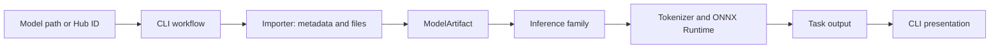

# HuggingRust design

## Purpose

HuggingRust is a Rust workspace for running text models that are already exported to ONNX. It resolves a Hugging Face repository or local model directory, downloads the files needed for inference, loads the tokenizer and ONNX graph, and offers a small interactive CLI for supported tasks.

The project aims to support more compatible model families and tasks over time. Compatibility depends on the ONNX graph signature, tokenizer, model family, and task outputs. Unsupported combinations should fail with a useful error rather than being treated as generic text models.

## Workspace layout

```text
crates/
  huggingrust/  Interactive command line and model loading workflow
  importer/     Hugging Face metadata, file selection, and local downloads
  inference/    Tokenization, ONNX Runtime execution, generation, and tasks
onnx_models/    Local model artifacts used for development
docs/           Project design and development notes
```

### `huggingrust`

The binary crate owns user interaction and orchestration. `input` parses a local path or Hub identifier and collects task input. `workflow` resolves metadata and constructs a `ModelArtifact`. `models` uses inference's family and task mappings to derive the task choices shown to the user. `user_error` translates lower-level failures into CLI messages.

Keep terminal prompts and presentation here. Importing and inference crates should remain usable without the CLI.

### `importer`

The importer owns Hub access and model-file preparation. It reads repository metadata, identifies a supported ONNX graph plus required companion files, downloads missing files, and installs them under `onnx_models/<model>/`.

File selection and path validation belong at this boundary. The importer should not load ONNX sessions or tokenize input.

### `inference`

The inference crate owns the runtime path and canonical model-family and task-alias mappings. Model-family modules adapt encoder-only, decoder-only, and encoder-decoder graphs to common operations. The `onnx` module builds inputs and extracts named tensor outputs. `tasks` maps canonical task names and typed inputs to inference operations and task outputs. Tokenization is kept in one module and shared by the family adapters.

Add new behavior at the narrowest layer that owns it: graph signature support in `onnx`, family-specific execution in the family module, and task interpretation in `tasks`. Avoid duplicating graph-name selection or task-output parsing across model families.

## Runtime flow



Local directories bypass Hub resolution and must include a readable `config.json`. Hub downloads use repository metadata to choose the ONNX graph and associated inference files. Inference consumes a `ModelArtifact` so the runtime is not coupled to how files were obtained.

## Extension guidance

- Add model-family recognition and its loader in `inference::ModelFamily`.
- Add task aliases in `inference::canonical_task_name`; CLI task discovery uses the same mapping.
- Keep model file priority in one place within each crate; if selection logic needs to be shared across crates, introduce a shared type only when the dependency direction remains clear.
- Preserve named ONNX outputs when a task needs more than a single vector or generated sequence.
- Keep model assets out of normal source changes unless an asset is intentionally added; downloaded artifacts are ignored by Git.

## Current scope and known limits

The implementation supports text models in encoder-only, decoder-only, and encoder-decoder families, with ONNX execution and several task adapters. It does not export models: a compatible ONNX export must already exist in the Hub repository or local directory. Runtime graph signatures and tokenizer features still limit which models in a recognized family will run.

Model files are currently stored in a project-relative `onnx_models` directory. This is convenient for development, but a reusable library or installed CLI should eventually use an explicit configurable cache location. Task capability discovery still lives in the CLI because it combines Hugging Face metadata with the supported inference task mapping. If other clients need task discovery, that metadata-facing layer can move into a reusable model-information module.

## Development checks

After changing Rust source, format the workspace and run the relevant crate checks. For behavior changes, add focused tests for file selection, task mapping, or tensor handling at the layer that owns that behavior. Keep large ONNX artifacts out of unit tests unless the test specifically validates a real model integration.
